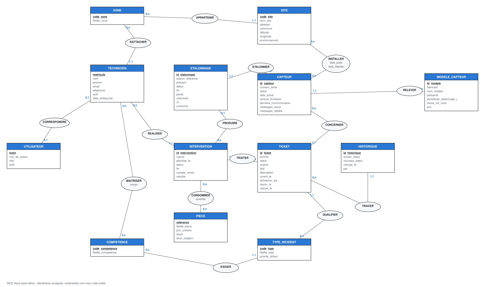
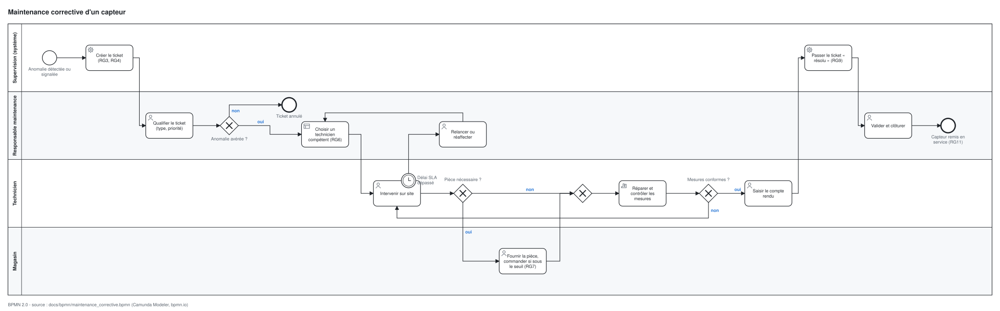

# Aeria · Back-office

[](https://github.com/brinis-aya/aeria-backoffice/actions/workflows/ci.yml)

Module 4 of **Aeria**, an open air-quality monitoring platform. The back-office manages the **sensor fleet**,
the **technicians** and the **maintenance**: incidents, interventions, calibrations, spare parts. It is designed
with the **Merise** method (MCD → MLD → MPD), its processes are modelled in **BPMN 2.0**, and its management rules
are enforced **in SQL** by PostgreSQL triggers and constraints.

> Other modules: [IoT sensors](https://github.com/brinis-aya/aeria-iot-sensors) ·
> [data pipeline](https://github.com/brinis-aya/aeria-data-pipeline) ·
> [24 h forecast](https://github.com/brinis-aya/aeria-forecast) ·
> [security](https://github.com/brinis-aya/aeria-security) ·
> [dashboard](https://github.com/brinis-aya/aeria-dashboard) ·
> [overview](https://github.com/brinis-aya/aeria)

## What is in here

| | |
|---|---|
| **Data model** | Merise MCD (13 entities, 15 associations), MLD, normalisation, 16 management rules: [`docs/merise.md`](docs/merise.md) |
| **SQL** | schema with `CHECK`/exclusion constraints, 16 functions and 9 triggers, 7 KPI views, 11 business queries: [`src/main/resources/db/migration`](src/main/resources/db/migration), [`sql/requetes_metier.sql`](sql/requetes_metier.sql) |
| **BPMN** | corrective maintenance, preventive calibration, sensor deployment: [`docs/bpmn`](docs/bpmn) (`.bpmn` files open in Camunda Modeler / bpmn.io) |
| **Application** | Spring Boot 3.5 + Thymeleaf + JdbcTemplate (SQL-first, no ORM), two roles, read-only JSON API |
| **Demo data** | one year of fleet life around Le Havre (12 sites, 16 sensors, 7 technicians, 150 tickets, 170 interventions), replayed **through** the triggers |
| **Tests** | 24 tests on a real PostgreSQL: one per management rule, plus roles, CSRF, ownership, account lockout and the security log |



## Processes (BPMN)



Also: [preventive calibration by co-location with a reference station](docs/bpmn/etalonnage_preventif.svg) and
[deployment of a new sensor](docs/bpmn/deploiement_capteur.svg). The automatic tasks of these diagrams are real:
`detecter_anomalies()` runs every 5 minutes, `planifier_etalonnages()` every morning, and finishing a successful
intervention moves the ticket to *résolu*.

## Rules in the database, not only in the code

```sql
-- RG2: a sensor is installed on one site at a time (time intervals must not overlap)
CONSTRAINT installation_sans_chevauchement EXCLUDE USING gist (
    capteur_id WITH =, tstzrange(date_pose, coalesce(date_depose, 'infinity'), '[)') WITH &&)

-- RG3: no duplicate alert - at most one active ticket per sensor and incident type
CREATE UNIQUE INDEX ux_ticket_actif ON ticket (capteur_id, type_code) WHERE statut IN ('ouvert', 'assigne', 'en_cours');
```

The ticket life cycle (ouvert → assigné → en cours → résolu → clôturé) is a state machine in a trigger; a
technician must be active and hold the required skill; stock never goes negative; two interventions of the same
technician cannot overlap; every status change is logged with its author. The application passes the user's
login to PostgreSQL (`SET LOCAL aeria.utilisateur`) and turns refusals into readable messages
("RG6 : le technicien 1 n'a pas la compétence HAUTEUR requise").

## Indicators (demo year)

| | |
|---|---|
| Average availability (365 days) | **99.5 %** (downtime periods merged with `range_agg`) |
| MTBF per sensor | 26 to 118 days; rural sites 80 days vs ~50 days in town |
| Urgent incidents (P1): MTTR / SLA met | ~6 h / 79 % (4 h SLA) |
| Calibrations conforming (R² ≥ 0.75, slope 0.7–1.3) | 30 / 35 |
| Maintenance cost | ≈ 11,800 € labour + 2,360 € parts over the year |

## Run it

```bash
docker compose up --build                  # PostgreSQL + app with the demo year, http://127.0.0.1:8084
```

Demo accounts (local demo only): `responsable` / `demo-responsable` (manager), and technicians `clefevre`,
`imorel`, `lnguyen`, `ybenali`, `hduval`, `tgirard` / `demo-technicien`.

Without Docker: create a PostgreSQL database and run
`mvn spring-boot:run -Dspring-boot.run.profiles=demo` with `DB_URL`, `DB_USER`, `DB_PASSWORD`.
Set `IOT_URL` (e.g. `http://127.0.0.1:8081`) to pull sensor health from module 1.

```bash
TEST_DB_URL=jdbc:postgresql://127.0.0.1:5432/backoffice_test mvn verify   # needs an empty test database
```

## Security (after the audit of module 5)

- listens on `127.0.0.1` by default (`SERVER_ADDRESS`), to be exposed through a TLS reverse proxy only;
- an account is locked for 15 minutes after 5 failed logins (same generic message, no user enumeration);
- security events on the `AERIA_SECURITY` logger (`event=login_failure user=… ip=…`), sanitised against log
  injection and decoded by the [Wazuh rules](https://github.com/brinis-aya/aeria-security/tree/main/wazuh);
- CSP, `X-Frame-Options`, `Referrer-Policy`, `Permissions-Policy`; Spring Boot 3.5.16 with patched Tomcat,
  Jackson and PostgreSQL driver.

## API (for the dashboard)

`GET /api/capteurs`, `GET /api/indicateurs`, `GET /api/tickets/actifs`: authenticated (session or HTTP Basic),
read-only JSON.

## Report

French report: [`docs/rapport.md`](docs/rapport.md).

## License

MIT
