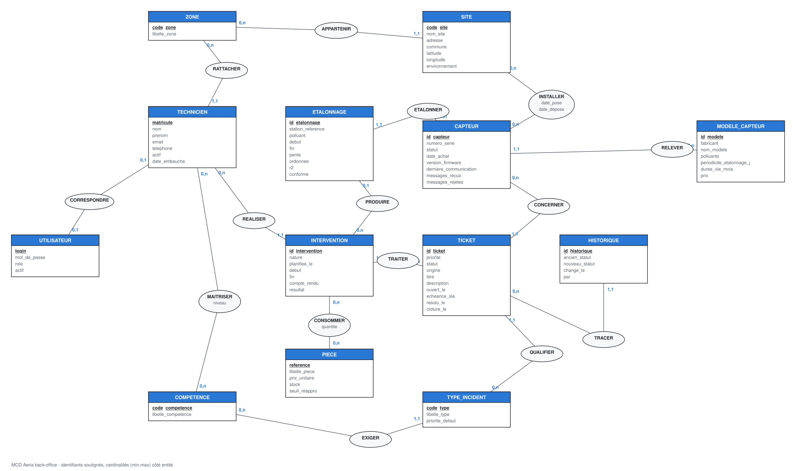

# Modélisation Merise — back-office Aeria

Démarche : règles de gestion → dictionnaire des données → MCD → MLD → MPD (`V1__schema.sql`).

## 1. Règles de gestion

| N° | Règle | Où elle est garantie |
|---|---|---|
| RG1 | Seul un capteur en stock ou en service peut être installé ; un capteur hors service ou réformé ne peut pas l'être. | trigger `installation_controle` |
| RG2 | Un capteur n'est installé que sur **un seul site à la fois** ; ses installations successives sont historisées. | contrainte d'exclusion `installation_sans_chevauchement` (GiST) |
| RG3 | Un capteur ne peut avoir **qu'un ticket actif par type d'incident** (pas de doublon d'alerte). | index unique partiel `ux_ticket_actif` |
| RG4 | La priorité par défaut dépend du type d'incident ; l'échéance (SLA) dépend de la priorité : P1 = 4 h, P2 = 24 h, P3 = 72 h, préventif = 10 jours. | trigger `ticket_avant_insertion`, fonction `delai_sla` |
| RG5 | Un ticket n'est « assigné » que si une intervention est planifiée ; on ne planifie rien sur un ticket terminé. | triggers `ticket_transition`, `intervention_controle` |
| RG6 | Le technicien d'une intervention est **actif** et **maîtrise la compétence** exigée par le type d'incident. | trigger `intervention_controle` |
| RG7 | Chaque pièce consommée décrémente le stock, qui ne devient **jamais négatif**. | trigger `piece_mouvement`, `CHECK (stock >= 0)` |
| RG8 | Cycle de vie du ticket : ouvert → assigné → en cours → résolu → clôturé ; annulation depuis ouvert/assigné ; replanification en cours → assigné ; réouverture résolu → en cours. Toute autre transition est refusée. | trigger `ticket_transition` |
| RG9 | Un ticket n'est résolu qu'après **une intervention réussie**. | trigger `ticket_transition` |
| RG10 | Un étalonnage est conforme si R² ≥ 0,75 et si la pente est entre 0,7 et 1,3 ; sinon un ticket « dérive » est ouvert. | trigger `etalonnage_conformite` |
| RG11 | Le statut du capteur suit la maintenance : en maintenance pendant une intervention, remis en service à la clôture. | trigger `ticket_apres_changement` |
| RG12 | Chaque changement de statut d'un ticket est tracé (date, auteur). | trigger `ticket_apres_changement` → `ticket_historique` |
| RG13 | Un technicien ne peut pas être sur deux interventions **en même temps**. | contrainte d'exclusion `intervention_technicien_disponible` |
| RG14 | Supervision : un capteur en service muet depuis plus d'une heure ouvre un ticket « silence » (P1) ; plus de 5 % de messages rejetés ouvre un ticket « dérive ». | fonction `detecter_anomalies()`, toutes les 5 min |
| RG15 | Un ticket d'étalonnage préventif est ouvert 7 jours avant l'échéance (dernier étalonnage conforme + périodicité du modèle). | fonction `planifier_etalonnages()`, chaque jour à 6 h |
| RG16 | Seul le responsable qualifie, planifie, clôture et annule ; un technicien ne démarre et ne termine que **ses** interventions. | Spring Security + contrôle d'appartenance |

Choix structurant : les règles RG1 à RG15 sont portées **par la base de données** (contraintes et triggers), pas
seulement par l'application. Elles s'appliquent donc à tout client : l'application web, un import, un script `psql`.

## 2. Dictionnaire des données (extrait)

| Code | Libellé | Type | Contrainte |
|---|---|---|---|
| id_capteur | Identifiant MQTT du capteur (module 1) | VARCHAR(32) | identifiant, ex. `LH-001` |
| numero_serie | Numéro de série fabricant | VARCHAR(40) | unique |
| statut (capteur) | État du capteur | VARCHAR(16) | en_stock, en_service, en_maintenance, hors_service, reforme |
| derniere_communication | Horodatage du dernier message reçu | TIMESTAMPTZ | alimenté par la supervision |
| periodicite_etalonnage_j | Intervalle entre deux étalonnages | SMALLINT | > 0 |
| code_site | Code du site d'installation | VARCHAR(16) | unique |
| environnement | Type d'environnement du site | VARCHAR(12) | urbain, trafic, industriel, rural |
| date_pose / date_depose | Période d'installation | TIMESTAMPTZ | dépose > pose ; dépose vide = installé |
| matricule | Matricule du technicien | VARCHAR(12) | unique |
| niveau | Niveau de maîtrise d'une compétence | SMALLINT | 1 à 3 |
| priorite | Priorité du ticket | SMALLINT | 1 (urgente) à 3 |
| statut (ticket) | État du ticket | VARCHAR(10) | voir RG8 |
| origine | Origine du ticket | VARCHAR(10) | auto, manuel, preventif |
| echeance_sla | Date limite de résolution | TIMESTAMPTZ | calculée (RG4) |
| resultat | Résultat d'une intervention | VARCHAR(10) | reussie, partielle, echec |
| quantite | Quantité de pièces consommées | INTEGER | > 0 |
| stock / seuil_reappro | Stock courant et seuil de commande | INTEGER | ≥ 0 |
| pente / ordonnee / r2 | Coefficients de la régression capteur ↔ station | NUMERIC | R² entre 0 et 1 |

Le dictionnaire complet correspond aux commentaires de `src/main/resources/db/migration/V1__schema.sql`.

## 3. Modèle conceptuel de données (MCD)

13 entités, 15 associations. Lecture des cardinalités, côté entité, par exemple :

- **CONCERNER** — un ticket concerne exactement un capteur (1,1) ; un capteur a de zéro à n tickets (0,n).
- **INSTALLER** — un capteur peut être installé sur plusieurs sites au cours de sa vie et un site peut recevoir
  plusieurs capteurs successivement (0,n — 0,n) ; l'association porte `date_pose` et `date_depose`.
- **MAITRISER** — association porteuse du `niveau` (1 à 3) entre TECHNICIEN et COMPETENCE.
- **CONSOMMER** — association porteuse de la `quantite` entre INTERVENTION et PIECE.
- **PRODUIRE** — un étalonnage est produit par au plus une intervention (0,1) : il peut aussi être importé.
- **CORRESPONDRE** — un compte utilisateur correspond à au plus un technicien (le responsable n'en a pas).

## 4. Modèle logique de données (MLD)

Notation : clé primaire <u>soulignée</u>, clé étrangère précédée de `#`.

- ZONE (<u>code</u>, libelle)
- SITE (<u>id</u>, code, nom, adresse, commune, latitude, longitude, environnement, #zone_code)
- MODELE_CAPTEUR (<u>id</u>, fabricant, nom, polluants, periodicite_etalonnage_j, duree_vie_mois, prix_unitaire)
- CAPTEUR (<u>id</u>, numero_serie, #modele_id, statut, date_achat, version_firmware, derniere_communication, messages_recus, messages_rejetes)
- INSTALLATION (<u>id</u>, #capteur_id, #site_id, date_pose, date_depose)
- COMPETENCE (<u>code</u>, libelle)
- TECHNICIEN (<u>id</u>, matricule, nom, prenom, email, telephone, #zone_code, actif, date_embauche)
- TECHNICIEN_COMPETENCE (<u>#technicien_id, #competence_code</u>, niveau)
- TYPE_INCIDENT (<u>code</u>, libelle, priorite_defaut, #competence_requise)
- TICKET (<u>id</u>, #capteur_id, #type_code, priorite, statut, origine, titre, description, ouvert_le, echeance_sla, resolu_le, cloture_le, ouvert_par)
- INTERVENTION (<u>id</u>, #ticket_id, #technicien_id, nature, planifiee_le, debut, fin, compte_rendu, resultat)
- PIECE (<u>id</u>, reference, libelle, prix_unitaire, stock, seuil_reappro)
- INTERVENTION_PIECE (<u>#intervention_id, #piece_id</u>, quantite)
- ETALONNAGE (<u>id</u>, #capteur_id, #intervention_id, station_reference, polluant, debut, fin, pente, ordonnee, r2, conforme)
- TICKET_HISTORIQUE (<u>id</u>, #ticket_id, ancien_statut, nouveau_statut, change_le, par)
- UTILISATEUR (<u>login</u>, mot_de_passe, role, #technicien_id, actif)

### Règles de passage appliquées

| Cas du MCD | Traduction | Exemples |
|---|---|---|
| Association (1,1) — (0,n) | clé étrangère du côté (1,1) | TICKET.#capteur_id, INTERVENTION.#ticket_id |
| Association (0,n) — (0,n) | table de jointure, clé composée des deux clés étrangères, attributs portés | TECHNICIEN_COMPETENCE, INTERVENTION_PIECE |
| Association (0,1) — (0,1) | clé étrangère **unique** d'un côté | UTILISATEUR.#technicien_id |
| Association (0,1) — (0,n) | clé étrangère facultative | ETALONNAGE.#intervention_id |
| Association historisée (0,n) — (0,n) | table avec **clé artificielle** : un même capteur peut revenir sur un même site, le couple (capteur, site) ne peut donc pas être identifiant | INSTALLATION |

Pour INSTALLATION, l'unicité « un site à la fois par capteur » (RG2) ne s'exprime pas avec une clé : elle porte
sur des **intervalles de temps**. Elle est garantie par une contrainte d'exclusion PostgreSQL qui interdit deux
périodes `[pose, dépose)` qui se chevauchent pour le même capteur.

### Normalisation

- **1FN** : tous les attributs sont atomiques. Seule exception assumée : `modele_capteur.polluants`, une liste
  courte et figée par le fabricant, lue mais jamais interrogée élément par élément.
- **2FN** : les tables à clé composée (TECHNICIEN_COMPETENCE, INTERVENTION_PIECE) n'ont qu'un attribut non-clé,
  qui dépend de toute la clé (le niveau dépend du technicien **et** de la compétence).
- **3FN** : pas de dépendance transitive. Par exemple, la compétence requise est portée par TYPE_INCIDENT et non
  par TICKET : elle se déduit du type. La zone d'un ticket n'est pas stockée : elle se déduit du site.
- **Dénormalisations volontaires**, toutes calculées par la base, jamais saisies :
  - `ticket.echeance_sla`, calculée à la création. Si la grille SLA change, les tickets existants gardent leur
    engagement d'origine ;
  - `ticket.priorite`, initialisée depuis le type mais modifiable ticket par ticket ;
  - les compteurs de télémétrie de CAPTEUR, simple copie de l'état fourni par le module 1.

## 5. Modèle physique (MPD)

PostgreSQL 15+, migrations Flyway :

| Fichier | Contenu |
|---|---|
| `V1__schema.sql` | tables, types, contraintes `CHECK`, index, contraintes d'exclusion, référentiels |
| `V2__regles_de_gestion.sql` | 16 fonctions SQL et PL/pgSQL, 9 triggers (RG1 à RG15) |
| `V3__vues_indicateurs.sql` | vues : état du parc, tickets enrichis, MTTR/SLA, disponibilité/MTBF, charge, stock, coûts |
| `db/demo/V100__donnees_demo.sql` | jeu de démonstration : une année rejouée à travers les triggers |

Choix physiques notables : `TIMESTAMPTZ` partout (heures d'été et d'hiver), index partiels sur les tickets actifs et
les interventions non terminées, extension `btree_gist` pour les contraintes d'exclusion, `range_agg` pour
fusionner les périodes d'indisponibilité dans le calcul de disponibilité.
