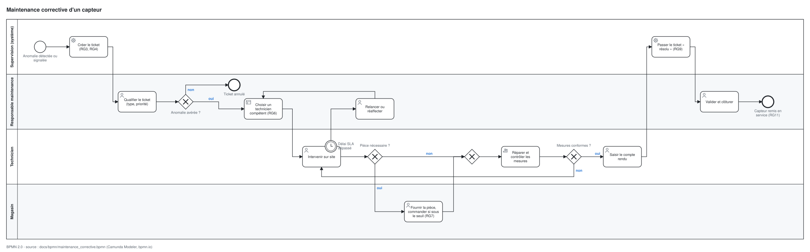
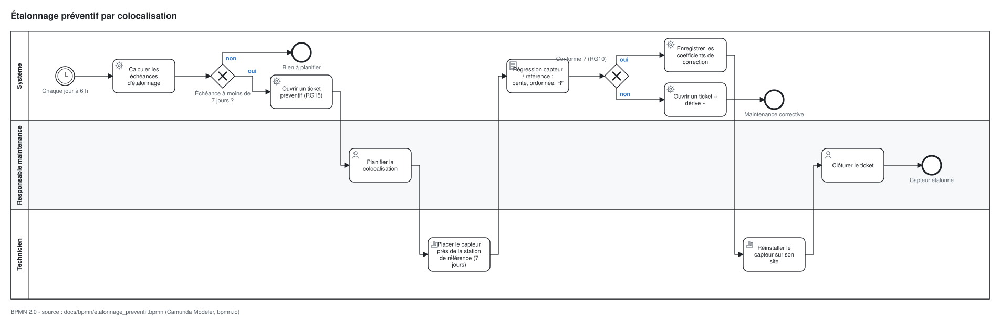
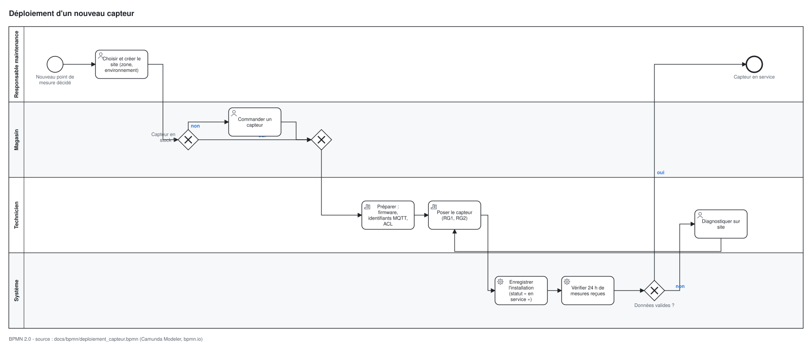
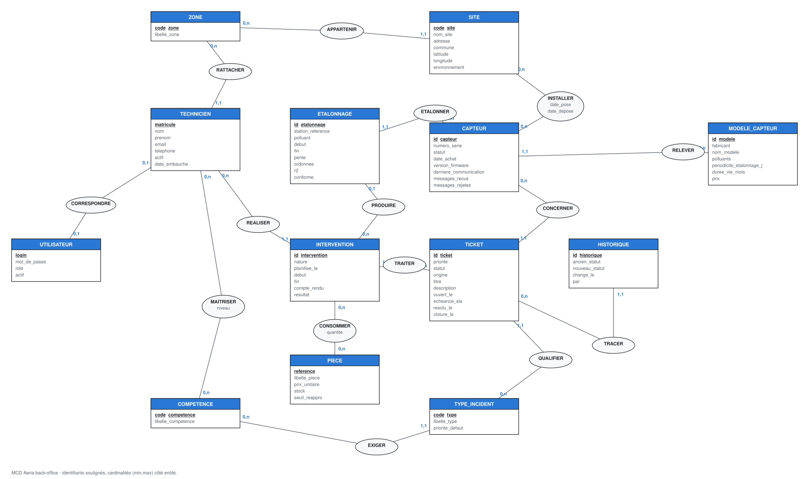

# Rapport — Module 4 : back-office de gestion du parc et de la maintenance

**Projet Aeria** — plateforme ouverte de surveillance de la qualité de l'air
Auteur : BRINIS Aya — novembre 2026
Dépôt : <https://github.com/brinis-aya/aeria-backoffice>

---

## 1. Contexte et objectif

Les modules 1 à 3 produisent des mesures, les nettoient et les prévoient. Un réseau de capteurs ne vaut
pourtant que par sa **maintenance** : un capteur muet, encrassé ou mal étalonné fausse silencieusement les
données. Ce module est le système d'information de gestion qui manque à Aeria :

- connaître le **parc** : quel capteur, quel modèle, sur quel site, dans quel état, depuis quand ;
- organiser la **maintenance** : détection des pannes, tickets, affectation au bon technicien, interventions,
  pièces détachées, étalonnages périodiques ;
- **piloter** : disponibilité, MTBF, délais de résolution, respect des engagements, coûts.

Démarche suivie, classique en MIAGE :

1. analyse des processus métier (BPMN) ;
2. règles de gestion et données (Merise : dictionnaire, MCD, MLD) ;
3. modèle physique et règles en SQL ;
4. application web au service des acteurs ;
5. tests et indicateurs.

## 2. Acteurs et périmètre

| Acteur | Rôle dans le système |
|---|---|
| Responsable maintenance | qualifie les tickets, planifie les interventions, valide et clôture, suit les indicateurs et le stock |
| Technicien | consulte le parc, démarre et termine **ses** interventions, saisit compte rendu et pièces |
| Supervision (système) | détecte les capteurs muets ou aux mesures anormales, planifie les étalonnages |
| Module 1 (capteurs IoT) | fournit l'état de santé des capteurs (dernier message, messages rejetés) via son API |
| Module 6 (tableau de bord) | lit l'état du parc et les indicateurs via l'API JSON |

## 3. Processus métier (BPMN 2.0)

Trois processus ont été modélisés en BPMN 2.0. Les fichiers `.bpmn` (XML standard OMG avec les coordonnées du
diagramme) s'ouvrent dans Camunda Modeler ou bpmn.io. Les images SVG sont générées à partir de la même
description (`scripts/diagrams.py`), donc les deux ne peuvent pas diverger.

### 3.1 Maintenance corrective

Quatre couloirs : supervision, responsable, technicien, magasin.

- Le processus démarre sur une anomalie, détectée automatiquement ou signalée.
- Le responsable qualifie le ticket (fausse alerte → annulation) puis choisit un technicien compétent.
- Le technicien intervient ; si une pièce est nécessaire, le magasin la fournit (et commande si le stock passe
  sous le seuil).
- Une boucle reprend l'intervention tant que les mesures ne sont pas conformes.
- Un **événement minuteur non interrompant** sur « Intervenir sur site » déclenche une relance quand le délai
  contractuel (SLA) est dépassé.
- Le système passe le ticket « résolu », le responsable valide et clôture.

### 3.2 Étalonnage préventif

Les capteurs basse coût dérivent. Le module 2 l'a montré : leur biais par rapport aux stations de référence
évolue. Chaque matin, le système calcule les échéances d'étalonnage. À 7 jours de l'échéance :

- il ouvre un ticket préventif ;
- le technicien place le capteur à côté d'une station de référence (Le Havre, FR05089 ou FR05090) pendant une
  semaine ;
- une régression linéaire capteur ↔ référence donne pente, ordonnée et R² ;
- si l'étalonnage est conforme, les coefficients de correction sont enregistrés ; sinon un ticket « dérive »
  bascule dans le processus correctif.

### 3.3 Déploiement d'un capteur

Choix du site, vérification du stock (commande sinon), préparation (firmware, identifiants MQTT et ACL du
module 1), pose, enregistrement de l'installation, puis contrôle de 24 h de données avant la mise en service.

**Du BPMN au code** : les tâches automatiques des diagrammes sont réellement implémentées.

| Tâche BPMN | Implémentation |
|---|---|
| « Anomalie détectée » | `detecter_anomalies()` toutes les 5 minutes |
| « Calculer les échéances » | `planifier_etalonnages()` chaque jour à 6 h |
| « Choisir un technicien compétent » | `proposer_techniciens()` |
| « Passer le ticket résolu » | déclenché quand le technicien termine une intervention réussie |

## 4. Modélisation des données (Merise)

Le détail est dans [`merise.md`](merise.md) : 16 règles de gestion, dictionnaire des données, MCD, MLD, règles de
passage et normalisation. Points saillants :

- **13 entités et 15 associations.** Trois associations sont porteuses de données : MAITRISER (niveau),
  CONSOMMER (quantité), INSTALLER (dates de pose et de dépose).
- **Historisation des installations.** Un capteur peut revenir sur un site où il a déjà été installé. Le couple
  (capteur, site) ne peut donc pas servir d'identifiant : la table INSTALLATION reçoit une clé artificielle, et
  la règle « un site à la fois » devient une contrainte sur des **intervalles de temps** (contrainte d'exclusion).
- **Compétences.** La compétence requise est portée par le type d'incident et non par le ticket (3FN). Cela
  permet la règle d'affectation : on n'envoie pas un technicien sans habilitation au travail en hauteur
  démonter un capteur sur un mât.
- **Traçabilité.** `ticket_historique` enregistre chaque changement de statut avec son auteur.

## 5. Implémentation SQL : la base garante des règles

### 5.1 Pourquoi dans la base ?

Une règle codée seulement dans l'application est contournée par le premier import CSV ou script de correction.
Les règles RG1 à RG15 sont donc garanties par PostgreSQL :

| Mécanisme | Règles |
|---|---|
| `CHECK` et clés étrangères | domaines de valeurs, stock ≥ 0, dépose > pose, cohérence rôle ↔ technicien |
| index unique **partiel** | RG3 : pas deux tickets actifs du même type sur un capteur |
| contraintes d'**exclusion** (GiST) | RG2 : pas deux installations simultanées ; RG13 : pas deux interventions simultanées pour un technicien |
| triggers PL/pgSQL | RG1, RG4 à RG12 : priorité et échéance, machine à états du ticket, compétences, stock, étalonnage, historique, état du capteur |
| fonctions | RG14, RG15 : supervision ; aide à l'affectation |

L'application transmet l'identifiant de l'utilisateur à chaque transaction (`SET LOCAL aeria.utilisateur`).
Les triggers savent ainsi qui a fait quoi, sans le confier au code applicatif. Les refus de la base sont
traduits en messages lisibles, par exemple « RG6 : le technicien 1 n'a pas la compétence HAUTEUR requise ».

### 5.2 Indicateurs en vues SQL

| Vue | Indicateur |
|---|---|
| `v_capteur_etat` | état courant du parc : site, statut, taux de rejet, prochain étalonnage, fin de vie |
| `v_ticket` | ticket enrichi, dépassement de SLA, durée, technicien |
| `v_kpi_mensuel` | MTTR et respect du SLA par mois et priorité |
| `v_disponibilite` | disponibilité et MTBF sur 365 jours ; les périodes d'arrêt qui se chevauchent sont fusionnées (`range_agg`) |
| `v_charge_technicien` | interventions à faire, activité sur 30 jours, compétences |
| `v_stock_alerte` | pièces sous le seuil, consommation sur 90 jours |
| `v_cout_mensuel` | coût mensuel : main-d'œuvre (taux interne de 45 €/h) et pièces |

### 5.3 Données de démonstration

Pour que les indicateurs aient un sens, une **année d'exploitation** est simulée : 12 sites autour du Havre
(dont les 6 du module 1), 16 capteurs de 3 modèles, 7 techniciens (dont une ayant quitté l'entreprise), 10 pièces.

L'historique est **rejoué jour par jour à travers les triggers** :

- incidents aléatoires, avec une graine fixe ;
- étalonnages planifiés par la fonction de supervision ;
- affectation par `proposer_techniciens()` ;
- échecs suivis de replanification ;
- vol d'un capteur en mai, réformé puis remplacé.

Le jeu de données ne contient donc aucun état que l'application ne pourrait pas produire. Pendant la
génération, une intervention a d'ailleurs été refusée pour conflit d'agenda (RG13), comme elle l'aurait été en
réalité.

## 6. Résultats sur l'année de démonstration

Requêtes dans [`sql/requetes_metier.sql`](../sql/requetes_metier.sql) (11 requêtes : agrégats, `ROLLUP`,
fenêtres glissantes, rangs, percentiles).

| Indicateur | Valeur |
|---|---|
| Tickets / interventions / étalonnages | 150 / 170 / 35 |
| Disponibilité moyenne des capteurs | **99,5 %** |
| MTBF | de 26 jours (Harfleur) à 118 jours |
| Urgences (P1) : délai moyen / respect du SLA de 4 h | 6 h / 79 % |
| Étalonnages conformes | 30 sur 35 |
| Coût annuel | ≈ 11 800 € de main-d'œuvre + 2 360 € de pièces |

| Incident | Tickets | Délai moyen | SLA respecté |
|---|---|---|---|
| Capteur muet | 46 | 5,9 h | 78 % |
| Étalonnage périodique | 35 | 86 h | 100 % |
| Panne matérielle | 28 | 5,2 h | 86 % |
| Mesures incohérentes | 27 | 16,6 h | 85 % |
| Dégradation ou vol | 14 | 8,5 h | 62 % |

Lecture :

- **Les capteurs muets sont l'incident n° 1.** Le plus souvent la connexion Wi-Fi du site, parfois
  l'alimentation. Une connectivité de secours (LoRa) réduirait fortement la charge.
- **Vandalisme** : c'est le pire respect du SLA (62 %), car il exige un technicien habilité au travail en
  hauteur, ressource rare dans certaines zones.
- **Environnement** : les sites ruraux ont un MTBF de 80 jours, contre une cinquantaine en ville et au bord des
  axes routiers.
- **Pièces** : la cellule NO₂ (165 €) est la pièce la plus coûteuse au total, alors que l'alimentation 12 V est
  la plus consommée (26 unités). Elle justifie un stock de sécurité plus élevé.
- **Charge** : la répartition est déséquilibrée. Inès Morel (zone portuaire, la plus polyvalente) réalise
  50 interventions contre 8 pour Thomas Girard. C'est un argument pour former d'autres techniciens à
  l'étalonnage.
- **Renouvellement** : les 5 capteurs « Mini » encore en service atteignent leur fin de vie théorique en
  novembre 2027, à budgéter.
- **Validation** : le responsable met en moyenne 26 h à valider un ticket résolu (90ᵉ centile : 45 h). C'est un
  délai que le SLA ne mesure pas et qu'il faudrait suivre.

## 7. Application web

Spring Boot 3.5, Thymeleaf, **JdbcTemplate sans ORM**. Le choix est volontaire : le modèle est relationnel, les
règles sont en SQL, et un ORM aurait masqué les requêtes au lieu de les montrer.

| Page | Contenu |
|---|---|
| Tableau de bord | 8 indicateurs, tickets prioritaires, interventions (toutes ou les miennes), indicateurs mensuels |
| Tickets | filtres actifs / hors délai / à valider / les miens / clos ; création manuelle ; lancement de la supervision |
| Ticket | détails, planification avec proposition de techniciens classés, démarrage et fin d'intervention avec pièces, validation, historique |
| Parc | statut, site, taux de rejet, disponibilité, MTBF, prochain étalonnage ; fiche capteur avec installations, tickets, étalonnages |
| Techniciens | compétences, charge, planning des interventions non terminées |
| Stock et coûts | pièces à commander, consommation, coûts mensuels |

Sécurité :

- authentification par formulaire, mots de passe hachés en BCrypt ;
- deux rôles, et un technicien n'agit que sur ses propres interventions ;
- jetons CSRF sur tous les formulaires, en-têtes CSP et anti-iframe ;
- l'API JSON (pour le module 6) répond 401 sans authentification ;
- à chaque transaction, l'application transmet l'identifiant de l'utilisateur à la base.

## 8. Tests

24 tests JUnit sur une **vraie base PostgreSQL**, recréée à chaque exécution (migrations et année de
démonstration). Les règles sont des triggers : une base en mémoire de type H2 ne les exécuterait pas.

- **12 tests de règles** :
  - un par règle : RG2, RG3, RG4, RG6, RG7, RG8, RG10, RG13, RG14 ;
  - le cycle de vie complet, avec l'historique et l'auteur ;
  - la proposition de techniciens ;
  - la cohérence des indicateurs.
- **5 tests de sécurité** ajoutés après l'audit du module 5 : écoute locale par défaut, verrouillage après
  5 échecs (même avec le bon mot de passe), remise à zéro après un succès, en-têtes, et journal de sécurité
  non falsifiable par un identifiant contenant un saut de ligne ;
- **7 tests web** : redirection vers la connexion, affichage des pages, interdictions par rôle, CSRF, technicien
  qui tente de démarrer l'intervention d'un collègue (403), message d'erreur RG3 remonté à l'utilisateur, API en
  HTTP Basic.

En CI (GitHub Actions), un conteneur PostgreSQL de service exécute les tests, les 11 requêtes métier et la
validation XML des fichiers BPMN et SVG, puis construit l'image Docker.

Pendant la recette dans le navigateur, deux défauts ont été trouvés et corrigés :

- la déconnexion renvoyait 403 : formulaire sans jeton CSRF ;
- un visiteur anonyme recevait 401 au lieu d'être redirigé vers la page de connexion. Le second fait désormais
  l'objet d'un test.

## 9. Durcissement après l'audit de sécurité (module 5)

L'audit du module 5 a relevé plusieurs constats sur ce module. Ils ont été corrigés, puis re-testés :

| Constat | Correction |
|---|---|
| Application à l'écoute sur toutes les interfaces, en HTTP | écoute sur `127.0.0.1` par défaut ; l'image Docker n'écoute sur toutes les interfaces qu'à l'intérieur du conteneur |
| Aucune limite de tentatives de connexion | compte verrouillé 15 minutes après 5 échecs en 15 minutes |
| Aucun événement de sécurité journalisé | journal `AERIA_SECURITY` (échecs, verrouillages, refus d'accès), protégé contre l'injection |
| En-têtes `Referrer-Policy` et `Permissions-Policy` absents | ajoutés |
| Spring Boot 3.5.7 : 76 vulnérabilités connues | 3.5.16 et versions corrigées de Tomcat, Jackson et du pilote PostgreSQL : 3 vulnérabilités restantes, sans impact ici |
| Couleur d'accent sous le contraste WCAG AA (4,4:1) | `#1d66bd` (5,7:1) |

## 10. Limites et suites

- **Données simulées** : l'année de démonstration est générée. Les indicateurs illustrent les calculs, pas un
  retour d'expérience réel.
- **Gestion des pièces** : le réapprovisionnement est signalé mais pas géré (bons de commande, fournisseurs,
  délais). C'est une extension naturelle du MCD : entités FOURNISSEUR et COMMANDE.
- **Moteur BPMN** : les processus sont implémentés « à la main ». Un moteur (Camunda, Flowable) exécuterait
  directement les `.bpmn`, au prix d'une dépendance lourde.
- **Planification** : l'aide à l'affectation classe les techniciens (zone, charge, niveau) mais ne construit pas
  de tournée. Une optimisation des déplacements serait utile au-delà de quelques dizaines de capteurs.
- **Mobilité** : une application mobile hors ligne pour les techniciens (photos, signature) compléterait
  l'interface web.

## 11. Lien avec les autres modules

- **Module 1** : identifiants des capteurs communs (`LH-001`…). La supervision lit `/api/sensors` (dernier
  message, messages rejetés) quand `IOT_URL` est défini.
- **Module 2** : les étalonnages par colocalisation utilisent les stations de référence de l'entrepôt.
- **Module 5** : rôles, journalisation des actions et contraintes d'intégrité alimentent l'analyse de risques.
- **Module 6** : l'état du parc et les indicateurs sont exposés en JSON pour la carte et les graphiques.
